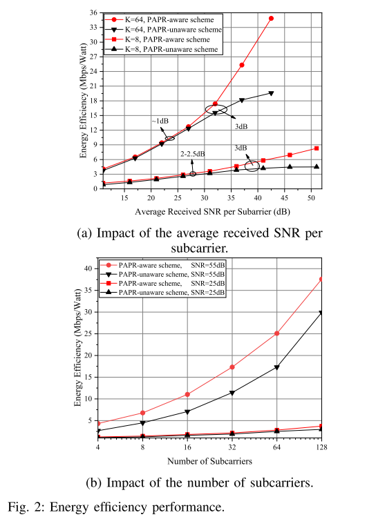
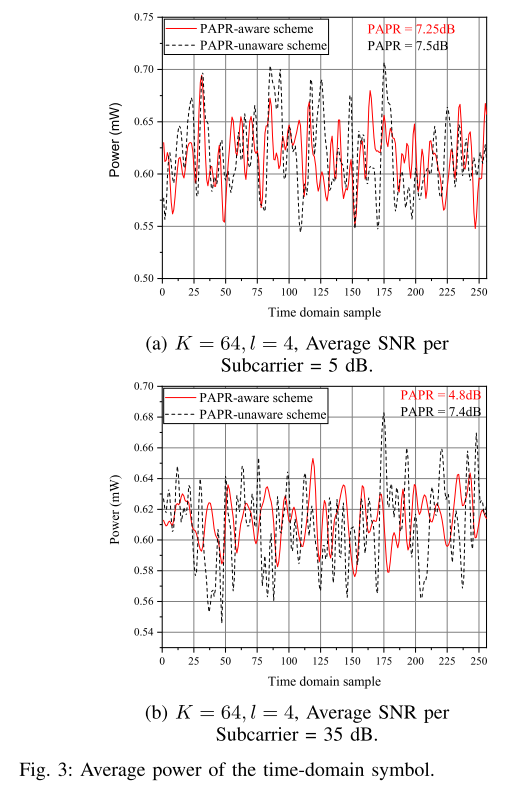
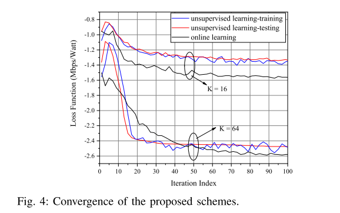

# Adaptive modulation based on intelligent PAPR - energy-efficient OFDM with Python code

Introduction: Recent studies have urgently called for the reduction of environmental impacts in future networks [1] and [2]. For this purpose, the energy efficiency of the 6th generation (6 G) wireless network is expected to be 10-100 times higher than that of the 5th generation (5G) network [1]. Furthermore, it is anticipated that the 6 G network will provide greater capacity by utilizing higher frequency bands, including millimeter wave (MMW) and terahertz (THz) waves. However, the increase in available spectrum due to high path loss and reduced power amplifier (PA) efficiency may limit the energy efficiency of the 6 G network [1].
Orthogonal Frequency Division Multiplexing (OFDM) has been identified as a key enabler beyond 5G and 6 G networks [1]. However, the energy efficiency of OFDM is limited by its peak signal-to-noise ratio (PSNR), which is a fundamental issue and increases with the number of data subcarriers [1], [3]. Therefore, considering hardware constraints, the design of an energy-efficient physical layer (PHY-L) MAC protocol for the 6 G network is necessary. To this end, the 6 G network will focus on building intelligence in both the physical layer and MAC layer, and introduce new features such as intelligent power control relying on native AI [2]. In fact, AI-based optimization is a viable method to solve real resource allocation problems, where the impact of hardware cannot be ignored [1], [2].
The reduction of peak-to-average power ratio (PAPR) in OFDM transmission and adaptive modulation have been widely studied in the past, but there has been no work combining both approaches. In [4] and [5], PAPR minimization is formulated as a convex optimization problem, but the study did not consider the data rate in OFDM transmission. Similarly, in [6] and [7], different clipping methods were proposed to reduce PAPR without considering adaptive modulation. Moreover, in [8] and [9], adaptive modulation in OFDM was studied, but the PAPR of OFDM time-domain signals was not considered. Additionally, in [10]-[12], deep learning-based adaptive modulation OFDM protocols were designed, but the PAPR in OFDM transmission was not studied.
In this work, we propose a PAPR-aware adaptive modulation and power allocation scheme based on deep neural networks (DNN). The goal of this work is to maximize the energy efficiency of OFDM transmissions. In our example, energy efficiency is defined as the ratio of throughput of PA to average power consumption. We observe that the consumption of PA depends on PAPR, which in turn depends on the power allocation and modulation for each subcarrier. Due to the non-convexity introduced by adaptive modulation following a classification distribution and PAPR, standard optimization tools are unable to solve this problem. Therefore, solutions employing online learning and unsupervised learning are proposed. Numerical simulations validate that the proposed protocol achieves an increase in energy efficiency compared to typical PAPR-unaware adaptive modulation protocols.
Simulation Results
Conclusion: A PAPR-aware protocol is proposed aiming to maximize the energy efficiency of OFDM transmissions. The problem of maximizing energy efficiency under power constraints is addressed with adaptive modulation constraints, and a solution based on deep learning is designed. Numerical results show that the proposed scheme increases the energy efficiency of OFDM transmissions by 3 dB. Thus, the proposed protocol can help meet the energy efficiency targets beyond those of 5G networks.

## Images

<!-- PAYMENT_BLOCK -->

## Get this dataset

- Payment link (Stripe): [Buy now](https://buy.stripe.com/3cs8yP7sY87d0vu9AB)
- Payment QR code: 

<!-- /PAYMENT_BLOCK -->
